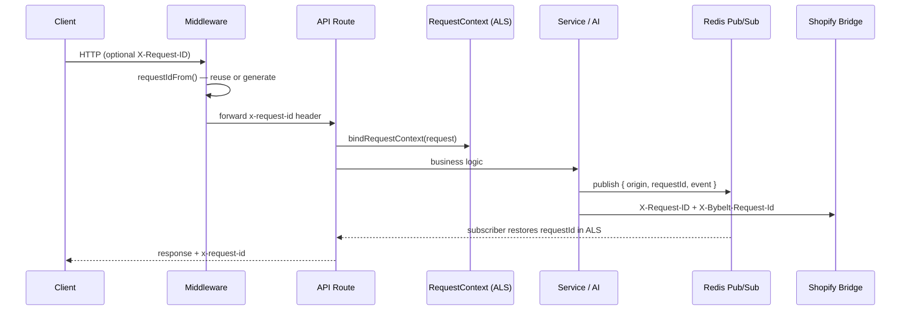

# Request Correlation & Structured Logging (Phase 24B)

Production observability foundation for the Bybelt platform. Every inbound
request receives a stable correlation id that propagates through middleware,
API handlers, services, AI pipelines, the Shopify bridge, Redis pub/sub, and
outbound HTTP calls.

## Correlation flow



## Request ID rules

| Rule | Behavior |
|------|----------|
| Incoming `x-request-id` | Reused as-is |
| Incoming `x-bybelt-request-id` | Reused (bridge compatibility) |
| Neither present | `crypto.randomUUID()` generated once in middleware |
| Same chain | Never regenerate — downstream reads the forwarded header |
| Outbound HTTP | Both `x-request-id` and `x-bybelt-request-id` set to the same value |

## RequestContext

Defined in `src/lib/logging/request-context.ts`. Stored in Node.js
`AsyncLocalStorage` and populated incrementally:

| Field | When set |
|-------|----------|
| `requestId` | Middleware + `bindRequestContext()` |
| `route`, `method`, `host`, `timestamp` | `bindRequestContext()` |
| `workspaceId`, `userId`, `operatorId` | After auth (`bindSessionRequestContext`) |
| `conversationId`, `channel`, `shop` | Route / service via `patchRequestContext()` |

Helpers:

- `bindRequestContext(request)` — route entry (idempotent for requestId)
- `bindSessionRequestContext(request)` — auth + workspace enrichment
- `patchRequestContext(partial)` — add fields as they become known
- `runWithRequestContext(ctx, fn)` — Redis subscriber replay
- `getRequestId()` / `getRequestContext()` — read active context

## Logger architecture

`src/lib/logging/logger.ts` — edge-safe core sink.

- Production: one JSON line per event
- Development: human-readable prefix
- `LOG_LEVEL` env: `debug` | `info` | `warn` | `error`
- Auto-merges active RequestContext when registered (Node.js only)
- `createComponentLogger("name")` — component field on every line

Standard fields on structured lines:

`timestamp`, `level`, `component`, `message`, `event`, `requestId`,
`workspaceId`, `conversationId`, `route`, `method`, `duration` / `durationMs`,
plus event-specific `metadata`.

## HTTP client

`src/lib/http/client.ts` — all new outbound calls should use this.

- Request-id propagation via `outboundRequestIdHeaders()`
- `AbortController` + configurable timeout (default 8s)
- Structured start / success / failure / retry logs
- `HttpClientError` with `kind`: `timeout` | `network` | `http` | `abort`
- Optional retry for transient failures

Shopify plugin internal API consolidated in
`src/lib/integrations/shopify-internal-client.ts` (replaces duplicated
`fetch()` in shopify-context / shopify-customers / shopify-sync-status).

## API route wrappers

| Wrapper | Use when |
|---------|----------|
| `withRequestLogging(handler)` | Health + routes needing duration log |
| `withApiRoute(handler)` | Standard API entry with context + headers |
| `bindSessionRequestContext(request)` | Authenticated routes (inbox SSE, etc.) |

## Shopify bridge tracing

**Main app → plugin:** `shopify-internal-client.ts` via `httpRequest` (logs +
request id).

**Plugin → main app:** `shopify-app/chat/app/lib/bridge-client.server.ts`
(already had structured logging; now also sends `X-Request-ID`).

Bridge logs: `bridge_request_start`, `bridge_request_ok`,
`bridge_request_retry`, `bridge_request_failed`.

## Redis correlation

`src/lib/inbox/event-bus.ts` Redis envelope (internal only — wire SSE format
unchanged):

```json
{ "origin": "<instance-uuid>", "requestId": "<optional>", "event": { ... } }
```

Subscribers call `runWithRequestContext({ requestId, workspaceId }, dispatch)`
so logs during SSE fan-out share the publisher's correlation id.

## AI logging

`src/lib/ai/audit-log.ts` → `createComponentLogger("ai-audit")`.

Every AI operation logs: `requestId`, `workspaceId`, `conversationId`,
`channel`, `model`, `latencyMs`, `decision`, `confidenceScore`,
`safetyDecision`, `success`, optional token fields.

Prompts and AI behavior are unchanged.

## Error tracking

`src/lib/observability/error-tracking.ts` merges explicit context with active
RequestContext. Captured exceptions include: `requestId`, `workspaceId`,
`conversationId`, `component`, `route`.

## Future extension points

| Extension | Hook |
|-----------|------|
| OpenTelemetry traces | Wrap `bindRequestContext` + propagate traceparent |
| Sentry / Datadog | `setErrorTracker()` + `setLogContextProvider()` |
| Log drain / warehouse | Replace logger sink in `logger.ts` |
| W3C Trace Context | Add `traceparent` alongside `x-request-id` in middleware |
| Per-route auto-wrap | Next.js instrumentation or codemod to `withApiRoute` |

## Files

| Path | Role |
|------|------|
| `src/lib/logging/request-id.ts` | ID generation + header constants |
| `src/lib/logging/request-context.ts` | ALS store + propagation helpers |
| `src/lib/logging/logger.ts` | Structured sink + component loggers |
| `src/lib/logging/request-log.ts` | Request duration logging |
| `src/lib/logging/api-handler.ts` | `withApiRoute` wrapper |
| `src/lib/logging/session-context.ts` | Auth-aware context binding |
| `src/lib/http/client.ts` | Outbound HTTP with correlation |
| `src/lib/integrations/shopify-internal-client.ts` | Shopify bridge client |
